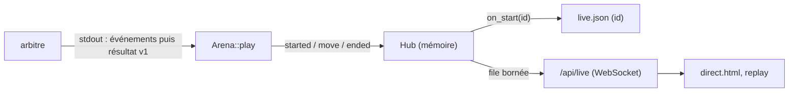
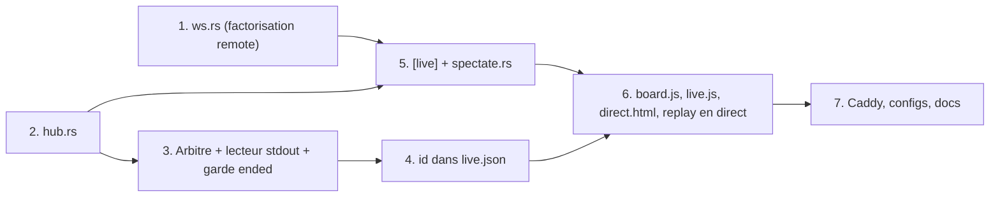

# Spec : direct des parties en cours

Statut : validée le 2026-11-01, décrit le commit `c0d9eea`.

## Problème

Pendant le tournoi, la page ne montrait qu'un tableau rafraîchi toutes les 15 s et des cartes « en cours », sans un seul coup. Le ladder ne voit d'ailleurs aucun coup avant la fin : l'arbitre, lancé dans son bac à sable, ne rend qu'un objet JSON quand la partie est finie.

### Objectifs

- Voir chaque partie en cours (ladder et tournoi) se jouer coup par coup.
- Une page `direct.html` qui montre toutes les parties en cours, projetable pendant le tournoi.
- Le replay (`index.html?game=<id>`) suit une partie en cours, puis la garde une fois finie.
- Aucune migration : ni données, ni config, ni contrat de l'arbitre.
- Des points de raccord stables pour le refactor v1.0 : le hub d'événements et le protocole spectateur. La source, le transport et la page sont des adaptateurs remplaçables.

### Hors périmètre

- Smoke tests : un jar candidat n'est jamais diffusé.
- Parties entre deux bots (`niveau-N`, `aleatoire`) : personne ne les regarde.
- Évaluation de position coup par coup. La seule prédiction est la probabilité d'avant-partie (`model.json`).
- Messages du spectateur (chat, abonnement par partie).
- Persistance : un redémarrage du ladder vide le direct. Les parties finies restent dans `games.jsonl`.

## Architecture



- **Hub** (`src/bin/ladder/hub.rs`) : la liste des parties en cours et des spectateurs, sous un seul verrou. Il rejoue chaque coup sur son propre plateau et ne bloque jamais une partie : envoi par `try_send`, et un spectateur dont la file est pleine est retiré.
- **Arena** : publie `started` après la création de l'id. Une garde publie toujours `ended`, y compris sur les chemins d'erreur, avec `cancelled: true` quand il n'y a pas de résultat validé. `play(.., live)` vaut `false` pour un smoke test.
- **Spectateurs** (`src/bin/ladder/spectate.rs`) : section `[live]` optionnelle, un thread par spectateur.

## Contrat de l'arbitre

Il ne change qu'en ajoutant des lignes. Avant le résultat, l'arbitre **peut** écrire sur sa sortie standard des lignes d'événement JSON, vidées à chaque ligne :

- `{"event":"ready"}` : les deux joueurs sont connectés, le chrono du premier coup démarre ;
- `{"event":"move","move":"G1-E3-C12","ms":1234}` : un coup client accepté.

Le résultat est la première ligne sans champ `event`, toujours en v1. Une ligne qui n'est pas du JSON est journalisée puis ignorée. Un arbitre qui n'écrit aucun événement (la CLI C++ officielle, par exemple) reste valable : sa partie apparaît en direct, mais sans coups.

## Protocole `/api/live` (v1)

Le serveur parle, le client se tait : toute trame texte ou binaire reçue ferme la connexion (code Policy).

```
{"v":1,"type":"snapshot","games":[{id,red,black,since,time_ms,tournament?,opening,moves,move_ms,turn_ms}]}
{"v":1,"type":"started","game":{…même forme…}}
{"v":1,"type":"move","id":"…","n":0,"move":"G1-E3-C12","ms":1234}
{"v":1,"type":"ended","id":"…","winner":"red","reason":"no_moves"}   (ou "cancelled":true)
```

- Le snapshot est construit et le spectateur inscrit sous le même verrou : aucun coup n'est perdu ni doublé.
- `n` est l'index du coup dans `moves`. Un trou fait reconnecter le client.
- `turn_ms` donne le temps écoulé depuis le dernier coup (ou depuis `ready`, ou `started`). Il est mesuré par le ladder, donc insensible au décalage d'horloge.
- Un coup illégal ou illisible coupe le direct de cette partie (journalisé). La partie elle-même n'est pas touchée.
- **Évolution** : la v1 ne reçoit que des ajouts (champs, `type`). Le client ignore ce qu'il ne connaît pas, et un `v` différent de 1 l'arrête (« page à mettre à jour »).

## Limites

| Limite | Valeur |
|---|---|
| Spectateurs simultanés | 512, séparés des 256 de `/api/remote` |
| Message entrant | 1 KiB, et aucun n'est accepté |
| File d'envoi par spectateur | 64 messages ; pleine, le spectateur est retiré |
| Écriture bloquée | 5 s (write timeout) |
| Silence (pas de pong) | 30 s, ping toutes les 10 s (Cloudflare coupe à 100 s) |
| Durée de vie d'une connexion | 2 h (Close 1000), le client se reconnecte |

Pas de limite par IP dans le code : derrière Caddy et Cloudflare, il faudrait faire confiance à un en-tête. Une règle de rate limiting Cloudflare sur `/api/live` est recommandée (`deploy/README.md`).

## Front et backend découplés

Le front se déploie sans le ladder (image `log200-scoreboard-web`, GitHub Pages) :

- **Front plus récent que le ladder** : si `/api/live` est absent, `direct.html` affiche « direct indisponible sur ce serveur » et réessaie avec un délai plafonné à 1 min. Sans `id` dans `live.json`, les badges ne sont pas cliquables.
- **Ladder plus récent que le front** : l'`id` ajouté à `live.json` est ignoré par l'ancienne page.
- **URL** : déduite de la meta `scoreboard-server` (http → ws, https → wss), que `pages.yml` et `web-entrypoint.sh` réécrivent dans toutes les pages.

## Page

- **`direct.html`** : un plateau par partie en cours. Chaque plateau montre les équipes, le contexte du tournoi (match, manche, score), la probabilité d'avant-partie, le temps du dernier coup et un compte à rebours. Une partie finie reste 30 s avec son résultat. Un clic ouvre le replay en mode direct.
- **Replay** (`index.html?game=<id>`) : si la partie est annoncée dans `live.json`, il suit le dernier coup en direct. Une fois la partie finie, il garde la partie construite et ne relit `games.jsonl` qu'au rechargement, `games.jsonl` étant mis en cache 15 s.
- **Liens** : les badges de duel (index) et les cartes « en cours » (tournoi) mènent à la partie quand `live.json` donne son `id`.
- **Reconnexion** : délai exponentiel avec jitter. Une partie absente du nouveau snapshot est marquée « interrompue ».

## Données

- `live.json` : chaque entrée gagne `id` dès que la partie a commencé. `since` garde son sens (attente d'un slot comprise). Le champ est ajouté sans rien changer d'autre.
- Rien d'autre n'est écrit sur disque.

## Arrêt et pannes

- **SIGTERM** : la boucle se termine, puis le hub ferme les files et chaque spectateur reçoit un Close 1001 (attente d'au plus 1 s).
- **Partie annulée** (arbitre, marqueur, timeout, validation) : `ended` avec `cancelled: true`.
- **Spectateur lent ou à moitié fermé** : retiré du hub dès que sa file est pleine. Son thread se libère en 5 s au plus (write timeout).

## Sécurité

- Endpoint public en lecture seule, sans authentification : il ne diffuse que ce que `games.jsonl` publie de toute façon à la fin de la partie.
- Aucune entrée client n'est interprétée.
- Le port 8092 n'est pas publié : on n'y accède que par la passerelle Caddy.

## Tests

- **Hub** : snapshot et inscription atomiques, suite des `n`, coup illégal (`broken`), file pleine (abonné retiré).
- **Lecteur stdout de l'Arena** : événements suivis du résultat, ligne non JSON, EOF sans résultat (`BadResult`).
- **Spectate**, sur vrai socket : chemin inconnu (404), snapshot puis `move`, trame entrante (fermeture).
- **`live.json`** : présence de l'`id`.
- **e2e** : l'arbitre émet `ready` puis un `move` par coup client.
- **`node --test`** : `liveUrl`, réducteur (trou, `ended`, `cancelled`, inconnu ignoré, `v` ≠ 1).

## Decisions Log

| ID | Topic | Decision | Rationale | Source | Date |
|---|---|---|---|---|---|
| D1 | Périmètre | Toutes les parties (ladder + tournoi), sans les smoke tests | Même plomberie ; un jar candidat ne doit pas être diffusé | Interview | 2026-11-01 |
| D2 | Calendrier | Implémenter maintenant ; la v1.0 adapte | Besoin du direct pour les prochains tournois | Interview | 2026-11-01 |
| D3 | Architecture | Hub d'événements interne, abonnés indépendants | Découple l'Arena des transports ; seuls le hub et le protocole doivent survivre à la v1.0 | Interview | 2026-11-01 |
| D4 | Migration | État en mémoire uniquement, ajouts seulement | Aucune migration de données ni de config | Interview | 2026-11-01 |
| D5 | Transport | WebSocket via tungstenite | Une seule technologie temps réel (déjà utilisée par `/api/remote`) | Interview | 2026-11-01 |
| D6 | UX | `direct.html` multi-plateaux + replay en mode direct, composant plateau partagé | Écran projeté + suivi d'une partie | Interview | 2026-11-01 |
| D7 | Limites | Plafond global de 512, client muet, file bornée ; pas de limite par IP | Ne pas faire confiance aux en-têtes derrière Caddy/Cloudflare | Interview | 2026-11-01 |
| D8 | Source des coups | Événements sur stdout, lecteur tolérant, résultat v1 inchangé | La CLI C++ officielle reste utilisable (sans coups) | Interview | 2026-11-01 |
| D9 | Protocole | Tout diffuser, snapshot à la connexion, aucun message entrant | Volume négligeable ; surface d'entrée nulle | Interview | 2026-11-01 |
| D10 | Listener | Section `[live]` dédiée et optionnelle | Le direct ne dépend pas de `[remote]` | Interview | 2026-11-01 |
| D11 | Affichage | Contexte tournoi, temps de réflexion, probabilité, liste des coups | Demandé | Interview | 2026-11-01 |
| D12 | Fin garantie | Garde `Drop` qui publie toujours `ended` (`cancelled` sans résultat) | Les sorties par `?` laissaient des plateaux figés | Red Team | 2026-11-01 |
| D13 | Spectateur bloqué | Write timeout de 5 s + pong sous 30 s, sans `shutdown` depuis le hub | Une seule voie de fermeture, bornée à 5 s | Red Team | 2026-11-01 |
| D14 | Cohérence | Snapshot et inscription sous le même verrou ; `n` sur `move` | Ni coup perdu ni doublon | Red Team | 2026-11-01 |
| D15 | `live.json` | `started` publié dans l'Arena ; `id` ajouté via `Report::Assigned` ; `since` inchangé | Badges cliquables sans changer le sens de `since` | Red Team | 2026-11-01 |
| D16 | Après `ended` | Le client garde la partie construite en direct | Cache de 15 s sur `games.jsonl` | Red Team | 2026-11-01 |
| D17 | Chrono | `turn_ms` relatif dans le snapshot, `ready` pour le premier coup | Insensible au décalage d'horloge | Red Team | 2026-11-01 |
| D18 | Boucle spectateur | Bloque sur sa file, puis lit en non-bloquant | Pas de scrutation à 50 ms × 512 | Red Team | 2026-11-01 |
| D19 | Smoke tests | `play(.., live: false)` | Voir D1 | Red Team | 2026-11-01 |
| D20 | Contrat arbitre | Flush à chaque ligne ; ligne non JSON ignorée et journalisée | stdout bufferisé en C++ | Red Team | 2026-11-01 |
| D21 | Arrêt | Close 1001, délai exponentiel + jitter, partie absente du snapshot = interrompue | Éviter que tous les clients se reconnectent en même temps | Red Team | 2026-11-01 |
| D22 | URL | `liveUrl()` dérivée de `SERVER`, meta sur `direct.html` | GitHub Pages / origine différente | Red Team | 2026-11-01 |
| D23 | Saturation | Durée de vie de 2 h par connexion + règle de rate limiting Cloudflare | 512 connexions muettes d'un seul script | Red Team | 2026-11-01 |
| D24 | Vue agrandie | Le clic dans `direct.html` ouvre le replay en mode direct | Évite une deuxième vue agrandie à maintenir | Interview | 2026-11-01 |
| D25 | Versions front/back | `/api/live` v1 en ajouts seulement ; client tolérant ; « direct indisponible » si l'endpoint manque | Le front (image web, Pages) se déploie sans le ladder | Interview | 2026-11-01 |
| D26 | Bots | Pas de direct pour une partie entre deux bots (`Team::is_bot`) | Sans intérêt pour les spectateurs | Interview | 2026-11-01 |

## Dependency Graph & Implementation Order



1. **`ws.rs`** : boucle d'accept, compteur de connexions, `refusal`, `goodbye`, extraits de remote sans rien changer à son comportement.
2. **`hub.rs`** : état, snapshot, publication, validation des coups, arrêt.
3. **Arbitre et Arena** : lignes d'événement, lecteur stdout tolérant, `started` et garde `ended`, `play(.., live)`.
4. **`live.json`** : `Report::Assigned`, champ `id`.
5. **`[live]` et `spectate.rs`** : handshake, boucle, limites.
6. **Front** : `board.js` extrait d'`app.js`, `live.js`, `direct.html`, mode direct du replay, liens depuis l'index et le tournoi.
7. **Déploiement et docs** : route Caddy, `[live]` dans les configs d'exemple, `docs/formats.md`, README.
